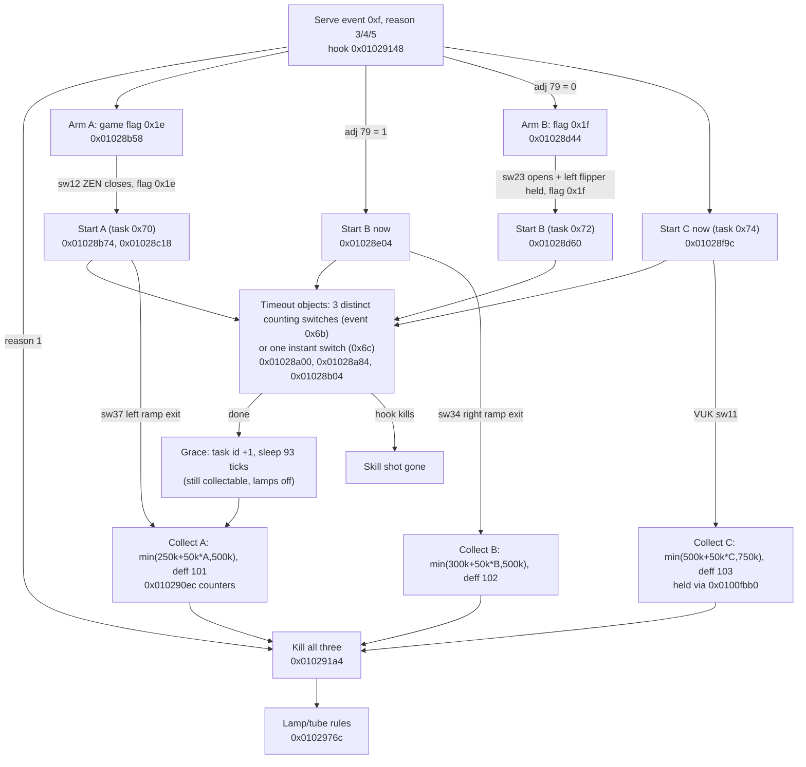

# Flow: skill shots (spec `rules/modes/skill_shots.md`, code block 0x01028a00-0x01029768)

Counters skA/skB/skC (RAM 0x2111814/18/1c + p-1) reset at the player's first ball (event 0x26, 0x010290ec).
