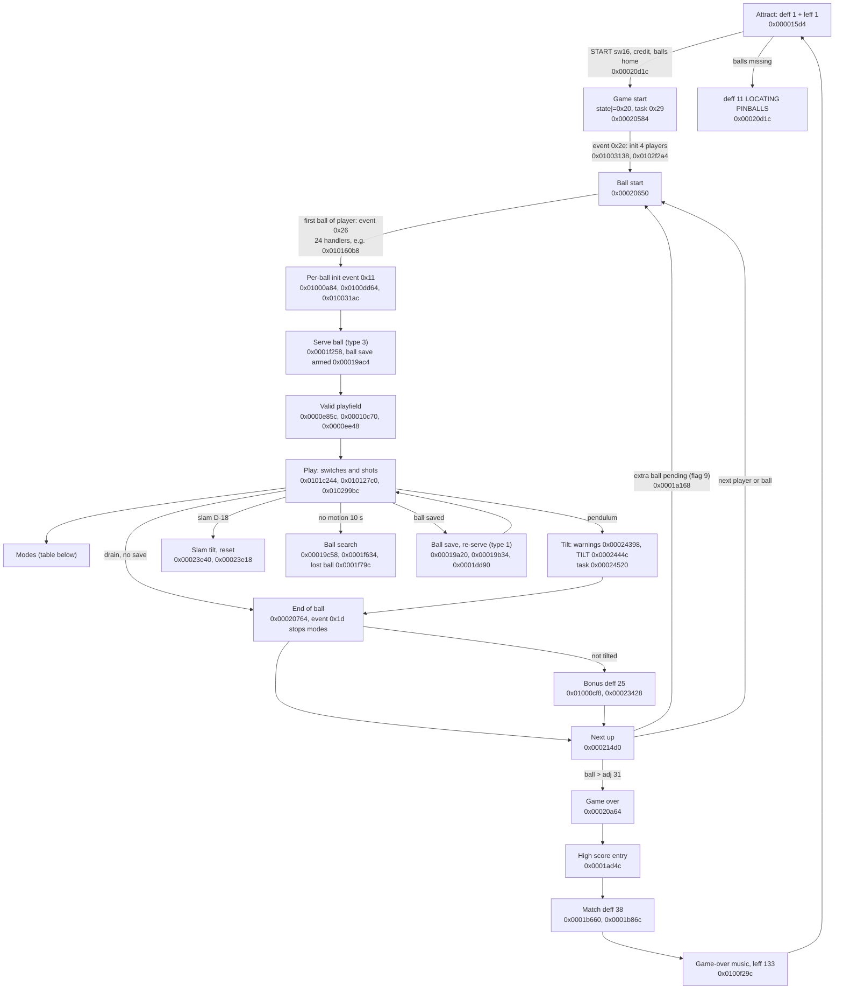

# Functional diagram (taken from the decompile, one ROM address per node)

Root diagram of the base game, Tron Legacy LE 1.74 (`trn_174h`). Every node carries the address of the
routine in `code/tron_game_decompiled_v2.c` (OS addresses below 0x36000, game code from 0x01000000). Sources:
`rules/modes/game_flow.md` sections 4 to 6 (each step cites its routine). The second level, one diagram per
mode, is the mode specs listed below; their entry routines are the nodes of the third table.
Status 2026-11-26: root level done, mode entries listed; per-mode node diagrams are still to be drawn from
the specs (open, see the end).

## Stop handlers of event 0x1d (end of ball), each ends one mode

End of Line MB flag 0x27 (0x010042d0), Disc MB 0x24 (0x01007074), Light Cycle MB 0x2b (0x01018804), Quorra MB 0x29
(0x0101cd7c), Portal MB 0x37 (0x0102f6c8), CLU hurry-up 0x01001c88, GEM 0x01013970, Sea of Simulation 0x01026784,
Zuse 0x01031664, mode objects 0x0100a244. [`game_flow.md` 6.1]

## Mode entries (nodes of level two; spec = `rules/modes/<file>`)

| Mode | Spec | Entry routines (ROM) |
|---|---|---|
| Attract and tournament pages | attract_and_service.md | 0x000015d4, 0x01034364, 0x01017dc4, 0x0100f29c |
| End-of-ball bonus | bonus.md | 0x01000cf8, 0x01000e7c, 0x01001374, 0x01000cb0 |
| CLU hurry-up | clu_hurryup.md | 0x01016b0c, 0x010167f4 |
| Combos | combos.md | 0x010031ac, 0x0100317c, 0x01003138 |
| End of Line (Daft Punk) MB | end_of_line_multiball.md, daft_punk_multiball.md | 0x010042d0, 0x01004238, 0x01004c68 |
| Disc MB | disc_multiball.md | 0x01007074, 0x010070b8, 0x0100769c, 0x0100781c |
| Find Flynn and items | find_flynn_and_items.md | 0x0100d698, 0x01016188, 0x0103129c |
| Flynn's Arcade | flynns_arcade.md | 0x0100df98, 0x0100dd38, 0x0100ddb0, 0x0100debc |
| GEM hurry-up | gem_hurryup.md | 0x010138f8, 0x010139b8, 0x01013c5c, 0x01013da8 |
| Light Cycle MB | light_cycle_multiball.md | 0x01018804, 0x0101b26c, 0x0102e8c0, 0x0102eaa4 |
| Portal MB | portal_multiball.md | 0x0102f6c8, 0x01000cd4, 0x0102f474 |
| Quorra MB | quorra_multiball.md | 0x0102e8c0, 0x0101cd7c, 0x0101f410, 0x0101f55c |
| Recognizer and Disc Battle | recognizer_and_disc_battle.md | 0x0101fd94, 0x010224ec, 0x010223c4, 0x010201e4 |
| Sea of Simulation | sea_of_simulation.md | 0x01026520, 0x01026794, 0x01026490 |
| Skill shots | skill_shots.md | 0x010290ec, 0x01029148 |
| Switches and shots | switches_and_shots.md | 0x0101c244, 0x010127c0, 0x010299bc, 0x0101c30c |
| TRON targets | tron_targets.md | 0x0100c558, 0x0100b294 |
| ZEN rollover | zen_rollover.md | 0x0103116c, 0x0103129c, 0x0102ac5c |
| ZUSE fast scoring | zuse_fast_scoring.md | 0x01031b88, 0x01033624, 0x01033680, 0x01033790 |

## Open (with the reason)

- Level two (one node diagram per mode, a ROM address per node): the specs hold the steps and addresses in
  prose; drawing them is the next work item, mode by mode, starting with the ones the bench flagged
  (Arcade bag total, GAME RESTART). Reason: size, not a missing source.
- Addresses of this root level were copied from `game_flow.md` and not yet re-read one by one in the decompile.
